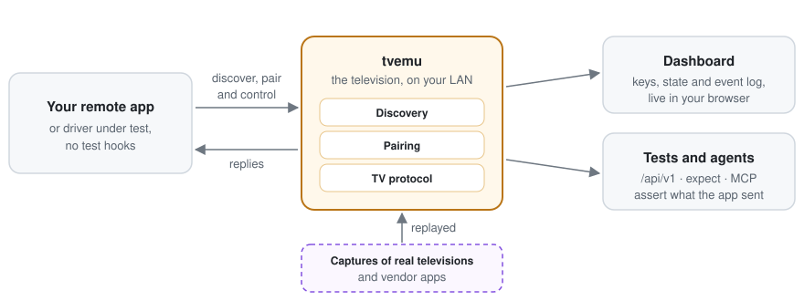
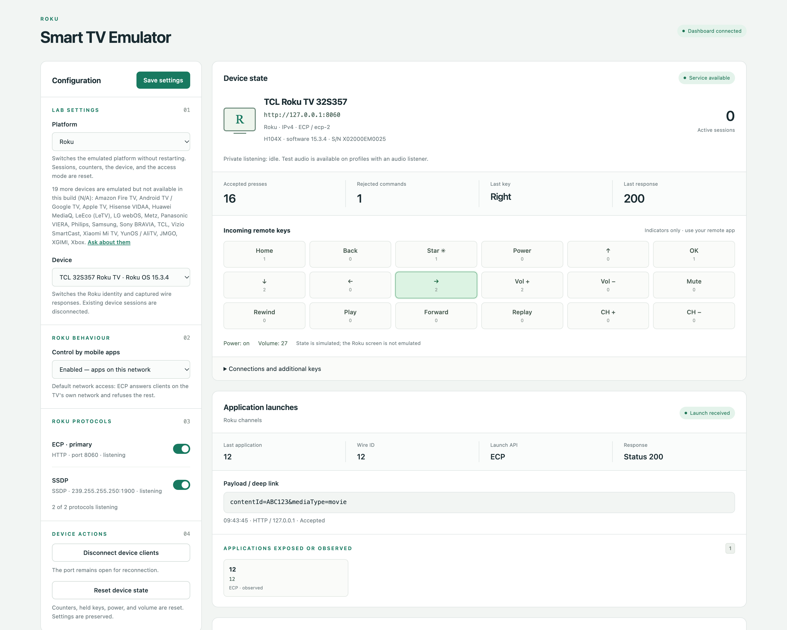
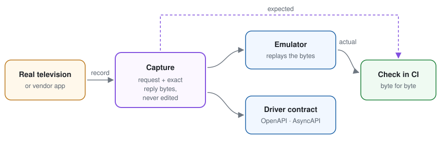

<h1 align="center">Smart TV Emulator</h1>

<p align="center">
  <b>Build and test a TV remote app without a television in the office.</b>
</p>

<p align="center">
  
  <a href="LICENSE"></a>
  
  <!-- generated:badges -->
  
  
  
  
  
<!-- /generated -->
</p>

A remote-control app has to find a television on the LAN, pair with it and drive it — and
every brand does each of those differently. This emulator is that television: one Python
process your app discovers, pairs with and controls exactly as it would a real set, with no
test hooks in the app. The answers are replayed from captures of physical hardware, and a
local dashboard shows you exactly what your app sent.



- **It answers like a real television.** SSDP and mDNS discovery, PIN and certificate
  pairing, and the real wire protocols — ECP, SSAP, Turnstile, JointSpace, SmartCast, MQTT
  over TLS, `samsung.remote.control` — including the firmware quirks and captured failures.
- **It shows what your app actually sent.** Live key presses, pairing state, one switch per
  protocol, exact app-launch payloads, and an event log you can export and assert on in CI.
- **It is a contract you can code against.** OpenAPI and AsyncAPI exports per television,
  a scenario checker over the event log, and an MCP server so a coding agent can close the
  loop itself.

<picture>
  <source media="(prefers-color-scheme: dark)" srcset="docs/images/dashboard-dark.png">
  
</picture>

## Quick start

Needs Python 3.11+ (the system Python 3.9 on macOS is too old). The easiest route is
[uv](https://docs.astral.sh/uv/), which fetches its own Python — no admin rights, no Homebrew:

```sh
curl -LsSf https://astral.sh/uv/install.sh | sh          # once, then open a new terminal
uvx --from git+https://github.com/evilutioner/smart-tv-emulator tvemu
```

<details>
<summary>With your own Python 3.11+, or from a clone</summary>

```sh
python3 -m venv .venv && source .venv/bin/activate
pip install git+https://github.com/evilutioner/smart-tv-emulator
tvemu
```

From a local clone (inside the venv above; Homebrew's Python refuses it outside one):

```sh
git clone https://github.com/evilutioner/smart-tv-emulator && cd smart-tv-emulator
python -m pip install .
tvemu
```

</details>

The dashboard opens at <http://127.0.0.1:8888>, and `Device:` shows the LAN address the
emulator picked. Keep the phone on the same network and let your app scan: it finds a
**TCL Roku TV 32S357** running Roku OS 15.3.4. To pick the address yourself, add
`--bind "$(ipconfig getifaddr en0)"`; `tvemu --help` lists every option, and the
[Changelog](CHANGELOG.md) what changed.

## Who it's for

| You are | What it gives you | Read next |
|---|---|---|
| **Testing a remote app by hand** | Pick a captured device — a real model on a real firmware — and go through discovery, pairing, keys, text and app launch. Switch the access mode or one protocol off, drop the connection, attach the exported event log to the bug. | [Testing an app](docs/testing-an-app.md), then your television's guide from the [table](#televisions) |
| **Writing a driver** | The OpenAPI and AsyncAPI exports in [`docs/spec/`](docs/spec), plus `tvemu --contract <id>` and `tvemu --api-map <id>`. Build step by step and check each one in the event log; test several firmwares by switching the device. | [Writing a driver](docs/writing-a-driver.md) |
| **Running automated tests and CI** | One loopback process. Reset state between cases through the [management API](docs/dashboard-and-api.md#management-api) and assert with `python -m tvemu.expect scenario.json`, which names the first event that did not come. | [CI](docs/ci.md), with a GitHub Actions job to copy |
| **Using a coding agent** | `claude mcp add tvemu -- tvemu-mcp` gives it `state`, `events`, `expect`, `reset`, `api_map`, `contract` and more; [`llms.txt`](llms.txt) is the map for a model. | [With an agent](docs/writing-a-driver.md#4-with-an-agent-the-mcp-server) |
| **Maintaining a client library** | Your library, installed untouched, runs against the emulator every week at its last green version and at the latest; what it asks for that no capture answers is listed as a gap. | [Open-source clients](docs/open-source-clients.md) |
| **Owning a television it lacks** | Send its model, firmware and the app you use, or record a capture yourself. | [Adding your television](docs/adding-your-television.md) |

## Televisions

<!-- generated:televisions -->
**In this repository**

| Television | Generations&nbsp;&nbsp;&nbsp;&nbsp;&nbsp;&nbsp;&nbsp;&nbsp;&nbsp;&nbsp;&nbsp;&nbsp;&nbsp;&nbsp;&nbsp;&nbsp;&nbsp;&nbsp;&nbsp;&nbsp;&nbsp;&nbsp;&nbsp;&nbsp;&nbsp;&nbsp;&nbsp;&nbsp;&nbsp;&nbsp;&nbsp;&nbsp;&nbsp;&nbsp; | Protocols | Devices | Tested with |
|---|---|---|---|---|
| **[Roku](docs/platforms/roku.md)** | ECP and ecp-2, Roku OS 15.3 | **3** protocols<br><sub>ECP over HTTP · authenticated ecp-2 WebSocket · SSDP roku:ecp</sub> | 📡&nbsp;2&nbsp;captured<br>✅&nbsp;2&nbsp;validated | ✅ [Roku for Android](https://play.google.com/store/apps/details?id=com.roku.remote)<br>🧪 [rokuecp](https://github.com/ctalkington/python-rokuecp), [python-roku](https://github.com/jcarbaugh/python-roku), [roku-client](https://github.com/bschlenk/node-roku-client) |

**Televisions on request**

| Television | Generations&nbsp;&nbsp;&nbsp;&nbsp;&nbsp;&nbsp;&nbsp;&nbsp;&nbsp;&nbsp;&nbsp;&nbsp;&nbsp;&nbsp;&nbsp;&nbsp;&nbsp;&nbsp;&nbsp;&nbsp;&nbsp;&nbsp;&nbsp;&nbsp;&nbsp;&nbsp;&nbsp;&nbsp;&nbsp;&nbsp;&nbsp;&nbsp;&nbsp;&nbsp; | Protocols | Devices | Tested with |
|---|---|---|---|---|
| **[Amazon Fire TV](docs/platforms/firetv.md)** | **3**&nbsp;gens<br> | **7** protocols<br><sub>Turnstile over HTTPS · legacy ADB shell · DIAL and SSDP · Bonjour on Fire OS</sub> | 📡&nbsp;3&nbsp;captured<br>✅&nbsp;2&nbsp;validated | ✅ [Amazon Fire TV for iOS](https://apps.apple.com/app/id947984433)<br>🧪 [androidtv](https://github.com/JeffLIrion/python-androidtv), [uc-intg-firetv](https://github.com/mase1981/uc-intg-firetv) |
| **[Android TV / Google TV](docs/platforms/androidtv.md)** | Remote v2, Android 11 to 14 | **11** protocols<br><sub>Remote v2 over mutual TLS · Polo pairing · Cast and DIAL launch · AirPlay identity · Bonjour</sub> | 📡&nbsp;6&nbsp;captured<br>✅&nbsp;2&nbsp;validated | ✅ [Google TV for iOS](https://apps.apple.com/app/id746894884)<br>🧪 [androidtvremote2](https://github.com/tronikos/androidtvremote2), [pychromecast](https://github.com/home-assistant-libs/pychromecast) |
| **[Apple TV](docs/platforms/appletv.md)** | Companion link, tvOS 26.5 | **2** protocols<br><sub>Companion link over TCP 49153 · HAP PIN pairing · sealed OPACK · Bonjour</sub> | 📡&nbsp;1&nbsp;captured | 🧪 [pyatv](https://github.com/postlund/pyatv) |
| **[Hisense VIDAA](docs/platforms/vidaa.md)** | MQTT over TLS, VIDAA U7 | **2** protocols<br><sub>MQTT over TLS · UPnP capability probe · Live TV channel list</sub> | 📡&nbsp;1&nbsp;captured | — |
| **[Huawei MediaQ](docs/platforms/huawei.md)** | huawei-remote | **2** protocols<br><sub>huawei-remote key events over HTTP · TCP probe on 9001 · modelled</sub> | 📱&nbsp;1&nbsp;modelled | — |
| **[LeEco (LeTV)](docs/platforms/letv.md)** | JSON over UDP 9900 | **2** protocols<br><sub>JSON key datagrams over UDP 9900 · TCP probe on 13489 · modelled</sub> | 📱&nbsp;1&nbsp;modelled | — |
| **[LG webOS](docs/platforms/webos.md)** | SSAP, webOS 7.6 | **7** protocols<br><sub>SSAP over WSS · IME keyboard · pointer socket · DLNA renderer · four SSDP stacks</sub> | 📡&nbsp;4&nbsp;captured<br>✅&nbsp;1&nbsp;validated | ✅ [LG ThinQ for iOS](https://apps.apple.com/app/id993504342)<br>🧪 [aiowebostv](https://github.com/home-assistant-libs/aiowebostv), [bscpylgtv](https://github.com/chros73/bscpylgtv), [lgtv2](https://github.com/hobbyquaker/lgtv2), [pywebostv](https://github.com/supersaiyanmode/PyWebOSTV) |
| **[Metz](docs/platforms/metz.md)** | RCRService SOAP | **2** protocols<br><sub>RCRService SOAP over HTTP · SSDP upnp:rootdevice · modelled from the vendor's remote app</sub> | 📱&nbsp;1&nbsp;modelled | — |
| **[Panasonic VIERA](docs/platforms/viera.md)** | **2**&nbsp;gens<br> | **3** protocols<br><sub>NRC SOAP over HTTP, plain or PIN-paired and encrypted · volume, inputs and events · pointer and gamepad socket · driven by Panasonic TV Remote 2 and 3</sub> | 📱&nbsp;2&nbsp;modelled<br>✅&nbsp;2&nbsp;validated | ✅ [Panasonic TV Remote 3 for iOS](https://apps.apple.com/app/id1435893441), [Panasonic TV Remote 2 for iOS](https://apps.apple.com/app/id590335696)<br>🧪 [panasonic-viera](https://github.com/florianholzapfel/panasonic-viera) |
| **[Philips](docs/platforms/philips.md)** | JointSpace 6.1 | **6** protocols<br><sub>JointSpace v6 over HTTPS and HTTP · UPnP · SSDP · Bonjour</sub> | 📡&nbsp;1&nbsp;captured<br>✅&nbsp;1&nbsp;validated | ✅ [Philips TV Remote for iOS](https://apps.apple.com/gb/app/philips-smart-tv/id1479155903)<br>🧪 [ha-philipsjs](https://github.com/danielperna84/ha-philipsjs) |
| **[Samsung](docs/platforms/samsung.md)** | **10**&nbsp;gens · 2011&nbsp;→&nbsp;2025<br> | **16** protocols<br><sub>Tizen: samsung.remote.control over WSS · device API · DIAL description; 2014–15: SPC PIN pairing · encrypted Socket.IO companion channel · multiscreen API; pre-2014: iApp remote on 55000 or HTTP 8080 · SECWOW wake · SSDP</sub> | 📡&nbsp;4&nbsp;captured<br>📱&nbsp;9&nbsp;modelled<br>✅&nbsp;6&nbsp;validated | ✅ [Samsung Smart View for Android](https://play.google.com/store/apps/details?id=com.samsung.smartviewad)<br>🧪 [samsungtvws](https://github.com/xchwarze/samsung-tv-ws-api), [samsungtvws-async](https://github.com/xchwarze/samsung-tv-ws-api), [samsungtvws-encrypted](https://github.com/xchwarze/samsung-tv-ws-api), [samsungctl](https://github.com/Ape/samsungctl), [samsung-tv-control](https://github.com/Toxblh/samsung-tv-control), [samsung-tv-remote](https://github.com/Badisi/samsung-tv-remote), [samsung-remote](https://github.com/natalan/samsung-remote) |
| **[Sony BRAVIA](docs/platforms/bravia.md)** | ScalarWebAPI, IRCC and Remote v1 | **10** protocols<br><sub>ScalarWebAPI JSON-RPC · IRCC · Simple IP Control · PIN registration · Android TV Remote v1 · SSDP · Bonjour</sub> | 📡&nbsp;2&nbsp;captured | 🧪 [pybravia](https://github.com/Drafteed/pybravia) |
| **[TCL](docs/platforms/tcltv.md)** | **3**&nbsp;gens<br> | **7** protocols<br><sub>nScreen XML remote · T-Cast remote with optional AES · DLNA renderer · DIAL</sub> | 📡&nbsp;1&nbsp;captured<br>📱&nbsp;2&nbsp;modelled | 🧪 [tcl-remote](https://github.com/jarvis2f/tcl-remote) |
| **[Vizio SmartCast](docs/platforms/vizio.md)** | SmartCast REST, API 3.3 | **3** protocols<br><sub>SmartCast REST over HTTPS · DIAL and SSDP</sub> | 📡&nbsp;1&nbsp;captured | 🧪 [pyvizio](https://github.com/raman325/pyvizio) |
| **[Xiaomi Mi TV](docs/platforms/mitv.md)** | **3**&nbsp;gens<br> | **8** protocols<br><sub>TV Assistant HTTP, airkan pairing and RC · modelled</sub> | 📱&nbsp;3&nbsp;modelled<br>✅&nbsp;2&nbsp;validated | ✅ [Xiaomi TV Assistant for Android](https://sj.qq.com/appdetail/com.xiaomi.mitv.phone.tvassistant)<br>🧪 [pymitv](https://github.com/simse/pymitv) |
| **[YunOS / AliTV](docs/platforms/yunos.md)** | Binary remote on 13510 | **2** protocols<br><sub>Binary remote over TCP 13510 · SSDP YunOSTV search · modelled</sub> | 📱&nbsp;1&nbsp;modelled | — |

**Projectors and consoles on request**

| Television | Generations&nbsp;&nbsp;&nbsp;&nbsp;&nbsp;&nbsp;&nbsp;&nbsp;&nbsp;&nbsp;&nbsp;&nbsp;&nbsp;&nbsp;&nbsp;&nbsp;&nbsp;&nbsp;&nbsp;&nbsp;&nbsp;&nbsp;&nbsp;&nbsp;&nbsp;&nbsp;&nbsp;&nbsp;&nbsp;&nbsp;&nbsp;&nbsp;&nbsp;&nbsp; | Protocols | Devices | Tested with |
|---|---|---|---|---|
| **[JMGO](docs/platforms/jmgo.md)** | Anymote, three firmwares | **2** protocols<br><sub>Google TV Anymote over plain TCP 9005 · UDP broadcast discovery · modelled</sub> | 📱&nbsp;3&nbsp;modelled | — |
| **[XGIMI](docs/platforms/xgimi.md)** | **2**&nbsp;gens<br> | **4** protocols<br><sub>JSON over UDP 16750 or framed TCP 13145 · UDP broadcast discovery · modelled</sub> | 📱&nbsp;2&nbsp;modelled | — |
| **[Xbox](docs/platforms/xbox.md)** | SmartGlass, OS 10.0 | **3** protocols<br><sub>SmartGlass over UDP 5050 · ECDH connect, AES-CBC session · captured session, input modelled from OpenXbox</sub> | 📡&nbsp;1&nbsp;captured | — |
<!-- /generated -->

**Generations** — the remote-control stacks a vendor's firmwares have shipped, oldest
first; one platform can answer as several of them ·
📡 **Captured** — replayed from packet captures of a physical set ·
📱 **Modelled** — built from the vendor's own remote app, no set measured ·
✅ **Validated** — the vendor's own remote app was driven against it by hand
([ledger](docs/manual-validation.md)) ·
🧪 **Exercised** — an open-source client library runs against it every week
([clients](docs/open-source-clients.md)) ·
**On request** — written and tested, [not in this build](#the-other-televisions).

Every television also has its own unit and byte-for-byte replay test report in
[`docs/tests/`](docs/tests). Device names, ports, discovery, pairing, firmware versions and
every wire protocol by television: [Televisions and protocols](docs/televisions.md).

## Why you can trust the answers



- **Bytes, not a schema.** The emulator serves the captured bytes and changes them only at
  substitutions a profile declares (a token, a session id). The OpenAPI and AsyncAPI files
  are derived from the same captures, never the other way round.
- **Checked on every commit.** A replay harness sends each captured request to the running
  emulator and compares the answer with the capture byte for byte; a claim the evidence
  contradicts fails the build.
- **Driven by the clients people use.** The vendors' own remote apps, by hand; and
  open-source libraries — such as [rokuecp](docs/clients/roku.md), the one behind Home
  Assistant's Roku integration — installed untouched and re-run every week. What they ask
  for that no capture answers is listed, never invented.

The details: [Architecture](docs/architecture.md#the-contract).

## The other televisions

This repository is one complete television, not a demo: the **Roku** adapter — ECP over HTTP,
the authenticated `ecp-2` WebSocket, SSDP, all four *Control by mobile apps* modes and two
captured devices — runs on the same shared core, dashboard and API as every other one.

The televisions listed **on request** are written too, with their own profiles and
regression tests, and are shown greyed out in the dashboard so you can see what the emulator
covers. Each has an overview under
[`docs/platforms/`](docs/platforms); the full driver guides — every message, pairing step and
refusal, tied to the capture it came from — come with access.

If one of them is what you need, or you want a commercial agreement or help wiring the
emulator into your tests, [get in touch](https://marchik.dev). Bugs, and
Roku models or firmwares the emulator does not have yet, are welcome as
[issues](https://github.com/evilutioner/smart-tv-emulator/issues).
Changing the emulator itself: [Contributing](CONTRIBUTING.md).

## Limits

It records commands and simulates observable state; it does not run a television operating
system or render a screen. Not yet: complete application catalogues, Cast and AirPlay media
playback, speech recognition, several televisions in one process, and IPv6.

## About the author

I'm **Oleg Marchik** ([@evilutioner](https://github.com/evilutioner)). For about the last
three years I have been writing Smart TV drivers: the code in a remote-control app that
discovers a television on the LAN, pairs with it and drives it. This emulator is a personal
project.

## Licence

Everything in this repository — the shared core, the dashboard, the management API, the MCP
server and the Roku adapter with its captures — is [Apache License 2.0](LICENSE): use it,
change it and ship it, commercially included. See [`NOTICE`](NOTICE).

The other televisions in the table are not in this repository and are not covered by this
licence; see [The other televisions](#the-other-televisions).

## Trademarks

This is an independent project. It is not affiliated with, endorsed by or sponsored by any
television, streaming-device or app maker it mentions. Product and company names are
trademarks of their owners and appear here only to say which devices the emulator is
compatible with. Vendor logos in captured device images have been painted out.
